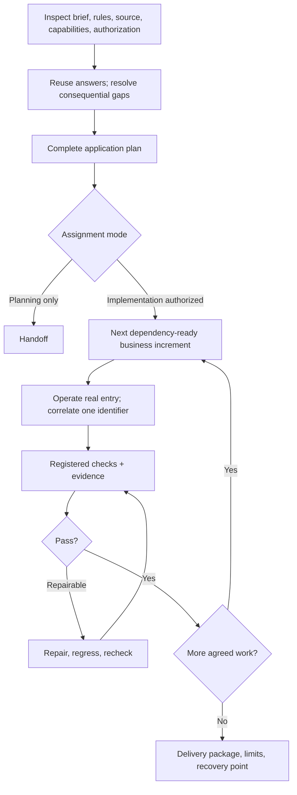

# App Module Delivery

[English](README.md) · [中文](README.zh-CN.md) · **v1.1.0**

[](https://github.com/KarmenLoop/app-module-delivery/actions/workflows/verify.yml)
[](https://github.com/KarmenLoop/app-module-delivery/releases/latest)
[](https://www.python.org/)
[](LICENSE)
[](skills/app-module-delivery/SKILL.md)

**Plan an application, register its acceptance checks, and keep real results with the requirements they verify—across desktop, mobile, web business, and CLI modules.**

App Module Delivery is a **portable agent skill** for greenfield apps, feature extensions, and module changes, plus a **Python CLI/MCP adapter** that runs only the exact commands the workspace owner registered. It stores exit codes, logs, and artifact hashes; changed evidence invalidates an earlier pass. A check can finish after its host connection closes; the next connection recovers that receipt without silently rerunning it.

Built and maintained by [KarmenLoop](https://github.com/KarmenLoop) / [KARMENLOOP](https://karmenloop.com). Current release: **[v1.1.0](https://github.com/KarmenLoop/app-module-delivery/releases/tag/v1.1.0)**. License: **KarmenLoop Source-Available No-Modification License 1.1**.


*Logical delivery route for v1.1.0—not a claim that every host or device path has been runtime-proven.*

[Download v1.1.0](https://github.com/KarmenLoop/app-module-delivery/releases/tag/v1.1.0) · [Tutorial](docs/tutorial.en.md) · [中文教程](docs/tutorial.zh-CN.md) · [Workflow](docs/workflow.md) · [Verification](docs/verification.md)

---

## Why this exists

“Build me an app” prompts often skip the hard seams: discovery without inventing facts, a complete plan before code, platform-specific interaction, permissions and data ownership, and acceptance that separates builds, screenshots, automation, and real operation.

This package treats application delivery as a **systems workflow**:

- reuse answered requirements; inspect technical facts yourself;
- ask only consequential business gaps (candidate pool, not a fixed quota);
- deliver a **complete plan before implementation**;
- advance **dependency-ready business increments** (entry + rules + permissions + data + feedback);
- register acceptance commands and keep **evidence with requirements**;
- resume from records that reconcile with actual files and processes—not status labels alone.

It does **not** supply a model, GUI automation, device farm, deployment permission, or scheduler. Registered checks must still cover the application’s real behavior.

---

## Snapshot

| | |
|---|---|
| **What you install** | Portable skill under `skills/app-module-delivery/` (`SKILL.md`, `references/`, templates, validation, agents metadata) |
| **Local adapter** | Python **3.11+** CLI/MCP host support (`skills/app-module-delivery/scripts/`) |
| **Version** | **1.1.0** (`VERSION`, skill `VERSION`, release tag, publication identity) |
| **Targets** | Desktop, mobile, web business, and CLI applications or modules |
| **Discovery** | 72-question candidate library; ask 4–6 consequential items per round |
| **Templates** | Application plan, architecture, module design, interaction contract, acceptance, progress |
| **CI** | GitHub Actions **Verify** on Linux / macOS / Windows: unittest, repository check, verifier regressions, package build, `check_publication.py` |
| **License** | Source-available, **no modification / no derivative distribution** of Materials without written permission; completed project records from `templates/` are expressly allowed (see [LICENSE](LICENSE)) |

---

## Is / Is not

| Is | Is not |
|---|---|
| Application-delivery **skill** + registered-check adapter | Hosted app builder or low-code platform |
| Plan → increments → evidence-linked acceptance | “Generate the whole app in one shot” |
| Exact owner-registered commands with exit codes, logs, hashes | Free-form shell that invents deployment authority |
| Receipt recovery across host reconnects | Automatic rerun of finished checks |
| Greenfield, extension, change, and narrow repair routing | Pure marketing-website workflow (use a website skill) |
| Honest NOT_RUN for native hosts / devices / perf | Claim that CI equals product acceptance |

---

## Architecture

Three layers stay distinct:

1. **Method layer (skill)** — `SKILL.md` routes discovery, planning, UI/UX, implementation, testing, delivery, and recovery. Stage references load only when needed. The skill adds instructions, not execution privileges.
2. **Project records** — Copy templates into *your* project; fill decisions and results. The license expressly permits completed project records; modified skill packages still need permission.
3. **Host adapter** — CLI/MCP operations run **exact** registered commands, persist receipts, and invalidate passes when artifact hashes change. Scheduling, remote identity, GUI control, and external actions remain host capabilities you must authorize separately.



Logical responsibilities (not a microservice prescription): [docs/workflow.md](docs/workflow.md). Adapter contracts: skill `references/host-adapter.md`.

---

## What the skill actually drives

### Discovery and planning

- Start from who must accomplish what and what success looks like.
- Use the [72-question library](skills/app-module-delivery/references/discovery.md) as a **candidate set**—not a mandatory questionnaire.
- Inspect source, configuration, interfaces, and tools yourself; ask humans for business decisions.
- Deliver a readable **complete application plan** (scope, scenarios, architecture, modules, data/permissions, platforms, UI/UX, sequence, acceptance) before implementation unless the user asked planning-only.

### Design and increments

- Study mature products for comparable tasks; translate into navigation, workspace, visual system, and interaction contracts.
- Prefer one representative core flow with realistic content and normal/loading/error/recovery states before expanding.
- Implement verifiable **business increments** across entry, rules, permissions, data, platform capabilities, and feedback—then operate them immediately.

### Testing, delivery, resume

- Connect real entry → processing → persisted record → later use through the **same** business/task identifier.
- Use PASS / FAIL / NOT_RUN / BLOCKED / INCONCLUSIVE / NOT_APPLICABLE; missing required evidence keeps acceptance incomplete.
- Persist decisions, defects, evidence, runtime entry points, and the next step. On resume, reconcile the record with actual files, processes, and tools before continuing.

---

## Quickstart

### A. Download and place the skill

1. Download the versioned ZIP and `SHA256SUMS` from [Releases v1.1.0](https://github.com/KarmenLoop/app-module-delivery/releases/tag/v1.1.0).
2. Extract the complete `app-module-delivery` directory (in a source checkout: `skills/app-module-delivery`).
3. Copy into **one** host-supported skill root. Prefer a fresh destination; inspect customized copies before replacing.
4. Refresh discovery or start a new session; open `SKILL.md` and confirm version **1.1.0**.

Platform paths and evidence matrix: [skills/app-module-delivery/references/platforms.md](skills/app-module-delivery/references/platforms.md). A file copy does not by itself prove native discovery.

### B. Suggested first prompt

```text
Use $app-module-delivery.
Task: [greenfield | extension | module change | narrow repair].
Application: [product, users, primary task].
Targets: [desktop / mobile / web business / CLI].
Existing material: [paths or supplied context].
Authority: deliver the complete plan first, then continue local implementation.
Acceptance: [critical end-to-end tasks and devices].
```

If you ask only for a plan, implementation should not start. If you authorize implementation without another gate, plan delivery should lead into work.

### C. Adapter and package checks (maintainers)

Python **3.11+** for the adapter; CI uses Python 3.12 for package tools:

```sh
python -m pip install -r requirements-dev.txt
python -B scripts/check_repository.py
python -B skills/app-module-delivery/validation/test_verifier.py
python -B scripts/package_skill.py --output-dir dist
```

Host tutorial: [docs/tutorial.en.md](docs/tutorial.en.md) · quick path: [docs/quickstart.md](docs/quickstart.md).

---

## Documentation map

| Doc | Use it when you need… |
|---|---|
| [Tutorial (EN)](docs/tutorial.en.md) · [中文](docs/tutorial.zh-CN.md) | Download, install, first assignment |
| [Quickstart](docs/quickstart.md) | Install → invoke → inspect |
| [Workflow](docs/workflow.md) | Next-step routing and contexts |
| [Verification](docs/verification.md) | Package vs application evidence |
| [Licensing](docs/licensing.md) · [LICENSE](LICENSE) | Source-available terms |
| [Platforms](skills/app-module-delivery/references/platforms.md) | Documented host directories and limits |
| [Host adapter](skills/app-module-delivery/references/host-adapter.md) | CLI/MCP registration and receipts |
| [VALIDATION](skills/app-module-delivery/VALIDATION.md) | Maintainer check record |
| [CHANGELOG](CHANGELOG.md) | Release history |
| [CONTRIBUTING](CONTRIBUTING.md) | Contribution expectations |

---

## Validation (honest)

**Hosted CI (`Verify`)** on push/PR across Linux, macOS, and Windows: repository checks, verifier regressions, package build, and `check_publication.py` (bilingual docs must contain version **1.1.0**; bound media/source digests must match).

Maintainer evidence in [VALIDATION.md](skills/app-module-delivery/VALIDATION.md) records package and tool checks. Live adapter/subprocess acceptance is documented for this line; **native loading across all documented hosts**, full agent behavior trials, and device/performance/recovery acceptance remain **NOT_RUN** unless a specific evidence file says otherwise.

**Not claimed**

- model supply, GUI automation, device farm, or deployment rights;
- that registered checks automatically cover product behavior;
- runtime proof of every documented third-party host path;
- permission to modify or redistribute altered Materials under the default license.

---

## FAQ

### What is App Module Delivery, in one sentence?

A source-available **application-delivery agent skill** that turns a brief into a plan, module contracts, and evidence-linked acceptance—plus a local CLI/MCP adapter that runs only owner-registered checks.

### Who should use it?

Teams using local coding agents to ship desktop, mobile, web business, or CLI applications who need a repeatable method for discovery, planning, increments, and honest acceptance—not a generic UI dump.

### Does the adapter grant deployment or payment authority?

No. It executes exact registered commands and stores receipts. External actions still need separate host authorization.

### Can a finished check rerun when I reconnect?

By design the adapter recovers the **same receipt** after a host reconnect without silently rerunning. Changed artifacts invalidate prior passes.

### May I modify the skill and publish a fork?

Under the default [LICENSE](LICENSE), you may use **unmodified** Materials, including commercial project work. **Modifying or distributing derivative Materials** needs prior written permission. Independently created applications produced with the unmodified skill are a separate exception; copying example/template **skill** content as a competing package is not. Filling `templates/` for your own project records is expressly allowed.

### Soft discoverability

Matching phrases: **application delivery agent skill**, **registered acceptance checks MCP**, **desktop mobile CLI module workflow**, **requirement to evidence traceability**, **business increment acceptance**. Substance is in the skill and adapter—not keyword density.

---

## License and contact

[KarmenLoop Source-Available No-Modification License 1.1](LICENSE) — see also [docs/licensing.md](docs/licensing.md). This is **not** an OSI-approved open-source license because it restricts modification and derivative distribution of the Materials.

Maintainer: [KarmenLoop](https://github.com/KarmenLoop) · Site: [karmenloop.com](https://karmenloop.com) · Permission requests: info@karmenloop.com

Issues: [GitHub Issues](https://github.com/KarmenLoop/app-module-delivery/issues).
