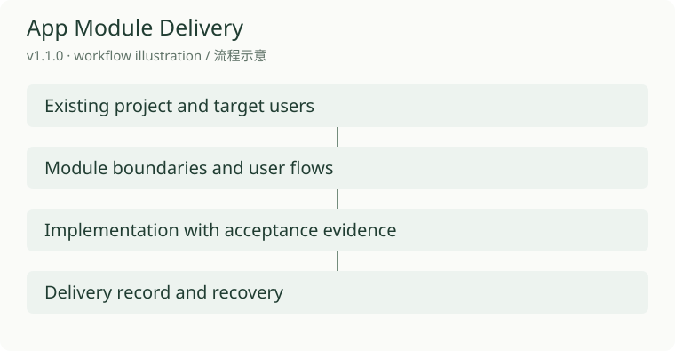
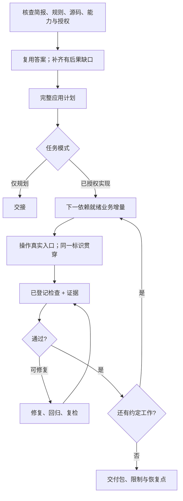

# App Module Delivery · 应用模块交付

[English](README.md) · [中文](README.zh-CN.md) · **v1.1.0**

[](https://github.com/KarmenLoop/app-module-delivery/actions/workflows/verify.yml)
[](https://github.com/KarmenLoop/app-module-delivery/releases/latest)
[](https://www.python.org/)
[](LICENSE)
[](skills/app-module-delivery/SKILL.md)

**规划应用、登记验收命令，并把真实结果与它们所验证的需求对应保存——覆盖桌面、移动、业务 Web 与 CLI 模块。**

App Module Delivery 是一套可移植的 **Agent Skill**，用于从零构建、功能扩展与模块变更；并附带 **Python CLI/MCP 适配器**，只执行工作区所有者预先登记的精确命令。它保存退出码、日志与产物哈希；产物变化会使先前的通过失效。宿主连接关闭后检查仍可完成；重连读取同一份收条，不会静默重跑。

由 [KarmenLoop](https://github.com/KarmenLoop) / [KARMENLOOP](https://karmenloop.com) 维护。当前版本：**[v1.1.0](https://github.com/KarmenLoop/app-module-delivery/releases/tag/v1.1.0)**。许可：**KarmenLoop Source-Available No-Modification License 1.1**。



*v1.1.0 逻辑交付路线——并不声称每个宿主或设备路径都已运行时证明。*

[下载 v1.1.0](https://github.com/KarmenLoop/app-module-delivery/releases/tag/v1.1.0) · [中文教程](docs/tutorial.zh-CN.md) · [English guide](docs/tutorial.en.md) · [工作流](docs/workflow.md) · [验收边界](docs/verification.md)

---

## 为什么做这个

「帮我做一个应用」的提示，常常跳过真正难的接缝：不编造事实的发现、写码前的完整计划、分平台交互、权限与数据归属，以及能区分构建、截图、自动化与真实操作的验收。

本仓库把应用交付当成 **系统工作流**：

- 复用已回答需求，技术事实自己核查；
- 只问有后果的业务缺口（候选题库，不是固定配额）；
- **先交完整计划，再实现**；
- 按依赖就绪的 **业务增量** 推进（入口 + 规则 + 权限 + 数据 + 反馈）；
- 登记验收命令，并把 **证据与需求** 对应保存；
- 用能与真实文件、进程对账的记录恢复——而不是只看状态标签。

它**不**提供模型、GUI 自动化、设备农场、部署授权或调度器。已登记检查仍须覆盖应用的实际行为。

---

## 一览

| | |
|---|---|
| **安装内容** | `skills/app-module-delivery/` 可移植 Skill（`SKILL.md`、`references/`、模板、校验、agents 元数据） |
| **本机适配器** | Python **3.11+** CLI/MCP 宿主支持（`skills/app-module-delivery/scripts/`） |
| **版本** | **1.1.0**（`VERSION`、技能 `VERSION`、发布标签、发布身份） |
| **目标** | 桌面、移动、业务 Web、CLI 应用或模块 |
| **发现** | 72 题候选库；每轮问 4–6 个有后果的问题 |
| **模板** | 应用计划、架构、模块设计、交互契约、验收、进度 |
| **CI** | GitHub Actions **Verify**（Linux / macOS / Windows）：unittest、仓库检查、校验器回归、打包、`check_publication.py` |
| **许可** | 源码可见、**禁止修改 / 禁止衍生分发** Materials（除非书面授权）；填充 `templates/` 形成的项目记录明确允许（见 [LICENSE](LICENSE)） |

---

## 是什么 / 不是什么

| 是 | 不是 |
|---|---|
| 应用交付 **Skill** + 已登记检查适配器 | 托管搭应用或低代码平台 |
| 计划 → 增量 → 证据挂钩的验收 | 「一句话生成整应用」 |
| 所有者登记的精确命令 + 退出码/日志/哈希 | 可自行发明部署权的自由 shell |
| 宿主重连后的收条恢复 | 对已完成检查静默重跑 |
| 从零 / 扩展 / 变更 / 窄修复路由 | 纯营销站工作流（请用网站类 Skill） |
| 对宿主/设备/性能的诚实 NOT_RUN | 宣称 CI 等同产品验收 |

---

## 架构

三层刻意分开：

1. **方法层（Skill）** — `SKILL.md` 路由发现、规划、UI/UX、实现、测试、交付与恢复；按阶段加载 `references/`。Skill 增加的是指令，不是执行权限。
2. **项目记录** — 把模板复制进**你的**项目并填写决策与结果。许可明确允许已完成的项目记录；改包分发仍需授权。
3. **宿主适配器** — CLI/MCP 只跑 **精确** 已登记命令，持久化收条，并在产物哈希变化时使通过失效。调度、远程身份、GUI 控制与对外动作仍属需另行授权的宿主能力。



逻辑职责（非微服务处方）：[docs/workflow.md](docs/workflow.md)。适配器契约：技能内 `references/host-adapter.md`。

---

## Skill 实际推动什么

### 发现与规划

- 从「谁要完成什么、成功长什么样」起步。
- 将 [72 题库](skills/app-module-delivery/references/discovery.md) 当作 **候选集**——不是必答题。
- 源码、配置、接口与工具自己查；业务决策问人。
- 在实现前交付可读的 **完整应用计划**（范围、场景、架构、模块、数据/权限、平台、UI/UX、顺序、验收），除非用户只要规划。

### 设计与增量

- 研究处理同类任务的成熟产品；落到导航、工作区、视觉系统与交互契约。
- 先用真实内容做一条代表性主流程（含正常/加载/错误/恢复），再扩展。
- 按可验证的 **业务增量** 实现（入口、规则、权限、数据、平台能力、反馈），并立即操作验证。

### 测试、交付、恢复

- 用 **同一** 业务/任务标识贯穿真实入口 → 处理 → 持久化 → 后续使用。
- 使用 PASS / FAIL / NOT_RUN / BLOCKED / INCONCLUSIVE / NOT_APPLICABLE；缺必证则验收不完整。
- 持久化决策、缺陷、证据、运行入口与下一步。恢复时先与真实文件、进程、工具对账再继续。

---

## 快速开始

### A. 下载并放置技能

1. 从 [Releases v1.1.0](https://github.com/KarmenLoop/app-module-delivery/releases/tag/v1.1.0) 下载版本 ZIP 与 `SHA256SUMS`。
2. 解压完整的 `app-module-delivery` 目录（源码检出中为 `skills/app-module-delivery`）。
3. 复制到 **一个** 宿主支持的技能根目录。优先新目录；替换前检查已定制副本。
4. 刷新发现或新开会话；打开 `SKILL.md` 确认版本 **1.1.0**。

平台路径与证据矩阵：[skills/app-module-delivery/references/platforms.md](skills/app-module-delivery/references/platforms.md)。文件复制本身不等于原生发现已证明。

### B. 建议首条提示

```text
使用 $app-module-delivery。
任务：[从零 | 扩展 | 模块变更 | 窄修复]。
应用：[产品、用户、主任务]。
目标平台：[桌面 / 移动 / 业务 Web / CLI]。
已有材料：[路径或已提供上下文]。
授权：先交完整计划，再继续本机实现。
验收：[关键端到端任务与设备]。
```

若只要计划，实现不应开始。若已授权实现且未另设门禁，交计划后应进入工作。

### C. 适配器与打包检查（维护者）

适配器需 Python **3.11+**；CI 用 Python 3.12 跑打包工具：

```sh
python -m pip install -r requirements-dev.txt
python -B scripts/check_repository.py
python -B skills/app-module-delivery/validation/test_verifier.py
python -B scripts/package_skill.py --output-dir dist
```

宿主教程：[docs/tutorial.zh-CN.md](docs/tutorial.zh-CN.md) · 捷径：[docs/quickstart.md](docs/quickstart.md)。

---

## 文档地图

| 文档 | 何时查阅 |
|---|---|
| [中文教程](docs/tutorial.zh-CN.md) · [English](docs/tutorial.en.md) | 下载、安装、第一次任务 |
| [快速开始](docs/quickstart.md) | 安装 → 调用 → 检查 |
| [工作流](docs/workflow.md) | 下一步路由与情境 |
| [验收边界](docs/verification.md) | 包证据 vs 应用证据 |
| [许可说明](docs/licensing.md) · [LICENSE](LICENSE) | 源码可见条款 |
| [平台](skills/app-module-delivery/references/platforms.md) | 宿主目录与限制 |
| [宿主适配器](skills/app-module-delivery/references/host-adapter.md) | CLI/MCP 登记与收条 |
| [VALIDATION](skills/app-module-delivery/VALIDATION.md) | 维护者检查记录 |
| [CHANGELOG](CHANGELOG.md) | 发布历史 |
| [CONTRIBUTING](CONTRIBUTING.md) | 贡献约定 |

---

## 验收（诚实）

**托管 CI（`Verify`）** 在 push/PR 上覆盖 Linux、macOS、Windows：仓库检查、校验器回归、打包，以及 `check_publication.py`（双语文档须含版本 **1.1.0**；绑定媒体/源码 digest 须匹配）。

[VALIDATION.md](skills/app-module-delivery/VALIDATION.md) 记录包与工具检查。本产品线有适配器/子进程相关说明；**全部文档宿主的原生加载**、完整 Agent 行为试验，以及设备/性能/恢复验收，除非某份证据文件另有说明，否则视为 **NOT_RUN**。

**不声称**

- 提供模型、GUI 自动化、设备农场或部署权；
- 已登记检查自动覆盖产品行为；
- 文档中每个第三方宿主路径都已运行时证明；
- 默认可修改或分发改动后的 Materials。

---

## 常见问题

### 一句话说明？

源码可见的 **应用交付 Agent Skill**：把简报变成计划、模块契约与证据挂钩的验收；并附带只跑所有者已登记检查的本机 CLI/MCP 适配器。

### 适合谁？

用本地编码 Agent 交付桌面、移动、业务 Web 或 CLI 应用，需要可重复的发现、规划、增量与诚实验收方法的团队——而不是再堆一套通用 UI。

### 适配器会授予部署或支付权限吗？

不会。它执行精确登记的命令并保存收条。对外动作仍需单独的宿主授权。

### 重连后会重跑已完成的检查吗？

设计上适配器在宿主重连后恢复 **同一份收条**，不会静默重跑。产物变化会使先前通过失效。

### 可以改 Skill 并公开发布分叉吗？

默认 [LICENSE](LICENSE) 下，你可使用 **未修改** Materials（含商业项目）。**修改或分发衍生 Materials** 需事先书面许可。用未改 Skill 独立做出的应用属单独例外；把技能示例/模板改成竞品包再分发则不是。填充 `templates/` 作为你自己的项目记录明确允许。

### 可发现性（轻量）

与本仓实质相符的表述：**应用交付 Agent Skill**、**已登记验收 MCP**、**桌面移动 CLI 模块工作流**、**需求到证据追溯**、**业务增量验收**。价值在 Skill 与适配器，不在堆砌关键词。

---

## 许可与联系

[KarmenLoop Source-Available No-Modification License 1.1](LICENSE) — 另见 [docs/licensing.md](docs/licensing.md)。因限制 Materials 的修改与衍生分发，这 **不是** OSI 认可的开源许可。

维护者：[KarmenLoop](https://github.com/KarmenLoop) · 站点：[karmenloop.com](https://karmenloop.com) · 授权请求：info@karmenloop.com

议题：[GitHub Issues](https://github.com/KarmenLoop/app-module-delivery/issues)。
