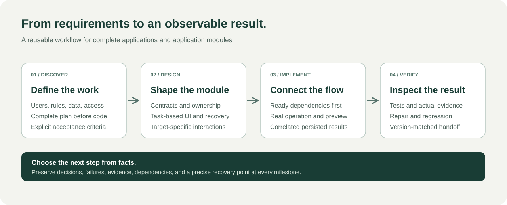
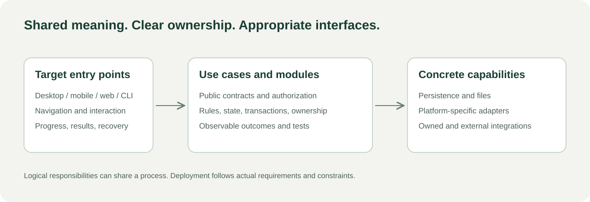

# How the workflow chooses the next step

The plan describes the agreed application. Implementation proceeds in complete business increments rather than disconnected frontend and backend phases.

| Situation | Next action |
| --- | --- |
| Business meaning is missing | Ask a focused question and propose a recommendation |
| Technical facts are unknown | Inspect source, configuration, interfaces, and tools |
| A major assumption may invalidate the plan | Run an authorized bounded experiment and update the route |
| Several tasks are ready | Compare dependency removal, business value, uncertainty, and observable completion |
| An increment fails | Reproduce, diagnose, repair, rerun, and regress affected behavior |
| One dependency is unavailable | Record its exact release condition and continue independent work |
| Required flows pass | Check the integrated candidate and delivery |
| Required evidence is missing | Hand over current work and a recovery point without claiming acceptance |

## One record, multiple layers

A flow might create a record, persist it, return its identifier, query it elsewhere, authorize a state change, and preserve the result through restart. The same identifier connects the evidence. This is an illustrative scenario, not a shipped sample application.

## Three contexts

Greenfield projects establish startup and the first real flow. Extensions reuse host identity, storage, public contracts, and lifecycle. Changes define preserved behavior, callers, compatibility, migration, cutover, and rollback before altering contracts or data.

Narrow repairs use affected steps. Planning-only requests remain planning-only. Existing authority and ownership continue to apply.

## Evidence and recovery

Keep source/runtime versions, uncommitted changes, decisions, dependencies, defects, commands, results, ownership, and next actions in the progress record.

On resumption, reconcile the record with actual files, processes, capabilities, and pending side effects. A status is not proof of a running process. A written wait condition is not a scheduler.

## Architecture

This is a logical model, not a prescription for microservices, frameworks, processes, or repositories. Data ownership, execution-side authorization, observable states, and recovery stay explicit wherever code runs.
